# Codebase Map — HP EliteBook 845 G8 Ryzen Tuning

> Generata in origine tramite l'infrastruttura di code intelligence (`code-intel` AST)
> Aggiornata a mano al: 2026-10-12, dopo il passaggio a un unico daemon (vedi sezione 2)

## 1. Panoramica del Progetto

Stack utente Linux per il tuning termico e di potenza su HP EliteBook 845 G8 (e piattaforme affini AMD Cezanne Zen 3).
Combina limiti hardware SMU tramite RyzenAdj, policy del kernel via AMD P-State EPP e cpufreq, un daemon unico che sceglie il profilo (batteria scarica, scelta manuale, gioco Steam, automatico AC/batteria) e applica l'overlay idle, guardie di integrità di sistema ed estensione GNOME Shell.

## 2. Architettura e Flusso dei Dati

```mermaid
flowchart TD
    subgraph HW["Hardware and kernel"]
        SMU["AMD SMU (RyzenAdj)"]
        CPUFREQ["/sys/devices/system/cpu/cpufreq (EPP, boost, max_freq)"]
        HWMON["/sys/class/hwmon (k10temp / zenpower)"]
        POWER_SUPPLY["/sys/class/power_supply (AC, Battery)"]
        PCI_DRM["/sys/bus/pci and /sys/class/drm (runtime PM, panel ABM)"]
    end

    subgraph CORE["Python stdlib (src/)"]
        COMMON["elitebook_common.py (sysfs helpers)"]
        PROFILES["elitebook_profiles.py (profiles, overrides, pure decisions)"]
        ENGINE["elitebook_engine.py (reconcile engine, Steam detection, thermal record)"]
        DAEMON["elitebook-thermal-profile daemon (1 s tick, control socket)"]
        CLI["elitebook-thermal-profile CLI (client)"]
        POWER_GUARD["elitebook-power-guard (watchdog and health guard)"]
        HIBERNATE["elitebook-hibernate-preflight (swapfile hibernate preflight)"]
    end

    subgraph STATE["Shared state (/run/elitebook-thermal-profile)"]
        CURRENT["current (base profile, SMU status)"]
        IDLE_STATE["idle-watcher (idle overlay)"]
        THERMAL["thermal (peak record)"]
        OVERRIDE["override (manual choice)"]
        CONTROL["control (root-only socket)"]
        RUNTIME_DEFAULTS["runtime-pm-defaults"]
        GUARD_STATE["guard (ok / degraded)"]
        FALLBACK["fallback (sysfs fallback, daemon down only)"]
        LOCK["dispatcher.lock (guard fallback only)"]
    end

    subgraph UI["User interfaces and system integrations"]
        GNOME_EXT["GNOME Shell extension"]
        SYSTEMD["systemd: elitebook-thermal-profile.service, power-guard .service and .timer"]
    end

    DAEMON --> ENGINE
    DAEMON --> PROFILES
    DAEMON --> COMMON
    ENGINE --> PROFILES
    ENGINE --> COMMON
    ENGINE --> SMU
    ENGINE --> CPUFREQ
    ENGINE --> PCI_DRM
    ENGINE --> HWMON
    ENGINE --> POWER_SUPPLY
    ENGINE --> CURRENT
    ENGINE --> IDLE_STATE
    ENGINE --> THERMAL
    ENGINE --> OVERRIDE
    ENGINE --> RUNTIME_DEFAULTS
    DAEMON --> CONTROL
    CLI -->|requests| CONTROL
    CLI -->|status reads| CURRENT
    POWER_GUARD --> COMMON
    POWER_GUARD -->|reassert via CLI| CLI
    POWER_GUARD --> GUARD_STATE
    POWER_GUARD -.->|only if daemon is down| FALLBACK
    POWER_GUARD -.-> LOCK
    HIBERNATE --> COMMON
    SYSTEMD --> DAEMON
    SYSTEMD --> POWER_GUARD
    GNOME_EXT -->|pkexec| CLI
    GNOME_EXT --> CURRENT
    GNOME_EXT --> IDLE_STATE
```

Un solo processo scrive le impostazioni di potenza: `elitebook-thermal-profile daemon`, avviato da `elitebook-thermal-profile.service` (`Type=notify`, con watchdog systemd). Ogni secondo raccoglie i fatti: alimentazione AC o batteria, percentuale batteria, carico CPU, gioco Steam in esecuzione, temperatura. `elitebook_profiles.py` decide il profilo base, con questa precedenza: protezione batteria scarica > scelta manuale > gioco Steam > automatico AC/batteria. Sopra il profilo base applica l'overlay idle. `elitebook_engine.py` confronta i valori target con quelli applicati l'ultima volta e scrive solo la differenza. Ogni impostazione viene riscritta una volta l'ora e subito dopo la ripresa dalla sospensione.

Il CLI non scrive più sysfs. I comandi di profilo (`ac`, `performance`, `battery`, `battery-saver`, `gaming`, `cool`, `auto`) e `reassert` sono richieste inviate al daemon tramite la socket Unix root-only `/run/elitebook-thermal-profile/control`. Il power guard chiede al daemon di riapplicare tutto e scrive sysfs direttamente solo se il daemon non è in esecuzione.

Perché questa forma: prima un dispatcher a scatto (regola udev su ogni evento AC/batteria, hook di sleep) e due demoni separati (idle watcher e Steam watcher) scrivevano gli stessi parametri, coordinandosi con un file di lock e con timestamp nei file di stato. Un livello di batteria aggiornato ogni minuto poteva riapplicare tutto, azzerare il record termico e sovrascrivere per un attimo l'overlay idle. Un solo proprietario che riconcilia verso un target elimina questa classe di bug.

## 3. Mappa dei Componenti e Simboli (`src/`)

I file del vecchio dispatcher e dei due watcher (`src/elitebook-idle-watcher`, `src/elitebook-steam-game-watcher`, le loro unit systemd, la regola udev e l'hook di sleep) non esistono più. Le loro funzioni sono in `elitebook_profiles.py`, `elitebook_engine.py` e nel daemon.

### [`src/elitebook_common.py`](src/elitebook_common.py)

Modulo helper stdlib-only condiviso. Legge sysfs, trova RyzenAdj, scrive policy CPU, runtime PM PCI e ABM del pannello. Non decide nulla.

| Simbolo | Tipo | Linea | Firma |
|---|---|---|---|
| `read_trimmed` | function | L38 | `def read_trimmed(path: Path) -> str` |
| `is_uint` | function | L47 | `def is_uint(value: str \| None) -> bool` |
| `read_key_value_file` | function | L51 | `def read_key_value_file(path: Path) -> dict[str, str]` |
| `on_ac_power` | function | L66 | `def on_ac_power(power_supply_dir: Path, *, default_when_unknown: bool = False) -> bool` |
| `battery_device` | function | L91 | `def battery_device(power_supply_dir: Path) -> Path \| None` |
| `battery_capacity` | function | L105 | `def battery_capacity(power_supply_dir: Path) -> int \| None` |
| `cpu_temperature_c` | function | L141 | `def cpu_temperature_c(hwmon_dir: Path) -> int \| None` |
| `find_ryzenadj` | function | L147 | `def find_ryzenadj(configured: str, search_paths: list[str]) -> str \| None` |
| `kernel_lockdown_mode` | function | L171 | `def kernel_lockdown_mode(lockdown_path: Path) -> str` |
| `acquire_dispatcher_lock` | function | L190 | `def acquire_dispatcher_lock(state_dir: Path, timeout_s: float) -> typing.TextIO` |
| `sysfs_value_matches` | function | L208 | `def sysfs_value_matches(path: Path, desired: str) -> bool` |
| `apply_cpu_policy` | function | L216 | `def apply_cpu_policy(cpufreq_dir: Path, epp: str, boost: str, max_freq: str, *, skip_unchanged: bool = False) -> list[str]` |
| `apply_smu_limits` | function | L315 | `def apply_smu_limits(ryzenadj_bin: str, stapm_mw: str, fast_mw: str, slow_mw: str, apu_mw: str, tctl_c: str, vrmmax_ma: str \| None = None) -> bool` |
| `apply_pci_runtime_pm` | function | L380 | `def apply_pci_runtime_pm(pci_devices_dir: Path, policy: str, defaults_file: Path) -> list[str]` |
| `apply_panel_power_savings` | function | L436 | `def apply_panel_power_savings(drm_dir: Path, level: str) -> str` |
| `write_atomic` | function | L460 | `def write_atomic(path: Path, content: str, mode: int = 0o644) -> None` |

### [`src/elitebook_profiles.py`](src/elitebook_profiles.py)

Profili, override di `profiles.conf` e decisioni pure. Il modulo non tocca hardware né orologio: dati i fatti dice quale profilo deve essere attivo e quali valori deve avere l'hardware. Per questo i test coprono ogni regola senza root né fixture sysfs.

| Simbolo | Tipo | Linea | Firma |
|---|---|---|---|
| `PROFILE_NAMES`, `SOURCE_*`, `IDLE_*` | constant | L22-L32 | nomi dei profili, sorgenti (`auto`, `manual`, `steam-game-watcher`) e stadi idle (`none`, `soft`, `deep`) |
| `Profile` | dataclass | L51 | valori completi di un profilo: EPP, boost, frequenza massima, limiti SMU, `tctl_c`, `vrmmax_ma`, `runtime_pm`, `panel_power_savings`, `tuned_profile` |
| `BUILTIN_PROFILES` | constant | L80 | valori di fabbrica dei sei profili |
| `ProfileConfig` | class | L114 | `ProfileConfig.load(path) -> ProfileConfig`, `get(key)` |
| `_Overrides` | class | L151 | applica le chiavi di `profiles.conf` a un profilo, con limiti e avvisi (interno) |
| `resolve_profile` | function | L274 | `def resolve_profile(name: str, config: ProfileConfig, battery_saver_max_freq_khz: int = ...) -> tuple[Profile, list[str]]` |
| `auto_profile` | function | L310 | `def auto_profile(on_ac: bool, battery_percent: int \| None, low_threshold: int) -> str` |
| `choose_base` | function | L320 | `def choose_base(on_ac: bool, battery_percent: int \| None, low_threshold: int, manual: str \| None, game_running: bool) -> tuple[str, str]` |
| `IdleSettings` | dataclass | L376 | soglie e valori degli stadi soft e deep. `IdleSettings.from_env(env=None)` legge le variabili `ELITEBOOK_*` |
| `IdleDetector` | class | L451 | `__init__(settings)`, `reset()`, `update(busy_percent, load1, allowed) -> str` (stadio idle) |
| `CpuPolicy` | dataclass | L497 | EPP, boost, frequenza massima |
| `SmuLimits` | dataclass | L504 | limiti SMU e `tctl_c` |
| `Target` | dataclass | L514 | valori target completi: `cpu`, `smu`, `runtime_pm`, `panel_power_savings`, `tuned_profile` |
| `lower_cap` | function | L522 | `def lower_cap(a: int \| None, b: int \| None) -> int \| None` |
| `target_for` | function | L531 | `def target_for(profile: Profile, idle_stage: str, idle: IdleSettings) -> Target` |
| `cap_battery_current` | function | L571 | `def cap_battery_current(target: Target, cap_ma: int \| None) -> Target` |
| `hardware_problem` | function | L593 | `def hardware_problem(vendor: str, product: str, cpu: str) -> str \| None` |

### [`src/elitebook_engine.py`](src/elitebook_engine.py)

Motore di riconciliazione: l'unico codice che scrive le impostazioni di potenza. A ogni tick riceve uno snapshot dei fatti, confronta il target con quanto applicato l'ultima volta e scrive solo le differenze. Contiene gli adapter hardware, il rilevamento Steam, il record termico e i file di stato.

| Simbolo | Tipo | Linea | Firma |
|---|---|---|---|
| `REASSERT_INTERVAL_S`, `RESUME_FOLLOWUP_S`, `SMU_RETRY_S`, `THERMAL_WRITE_SAMPLES` | constant | L39-L42 | riscrittura oraria (3600 s), follow-up dopo la ripresa (10 s), ritento SMU (300 s), scrittura periodica del record (60 campioni) |
| `now_iso` | function | L49 | `def now_iso() -> str` |
| `Log` | class | L53 | `Log(prog)`, `info(message)`, `warn(message)` |
| `Facts` | dataclass | L70 | snapshot dei fatti per tick: `now`, `on_ac`, `battery_percent`, `busy_percent`, `load1`, `game_running`, `temperature_c` |
| `CpuSampler` | class | L80 | `busy_percent() -> float`, da `/proc/stat` |
| `load1` | function | L105 | `def load1(loadavg: Path = Path("/proc/loadavg")) -> float` |
| `steam_appid_from_environ` | function | L128 | `def steam_appid_from_environ(environ_path: Path) -> str \| None` |
| `find_steam_game` | function | L165 | `def find_steam_game(...) -> tuple[dict[str, str] \| None, bool]` |
| `GameDetector` | class | L199 | `poll(now, on_ac) -> dict[str, str] \| None`: scansione a intervalli (20 s con Steam aperto, 30 s su AC, 120 s a batteria) |
| `Hardware` | Protocol | L241 | `apply_tuned`, `apply_cpu`, `apply_smu`, `apply_devices` |
| `SysfsHardware` | dataclass | L277 | adapter reale verso sysfs, RyzenAdj, tuned e runtime PM |
| `SysfsHardware.apply_tuned` | method | L242 | `def apply_tuned(self, tuned_profile: str) -> list[str]` |
| `SysfsHardware.apply_cpu` | method | L244 | `def apply_cpu(self, cpu: CpuPolicy) -> list[str]` |
| `SysfsHardware.apply_smu` | method | L246 | `def apply_smu(self, smu: SmuLimits) -> tuple[str, str \| None]` |
| `SysfsHardware.apply_devices` | method | L248 | `def apply_devices(self, runtime_pm: str, panel: int) -> tuple[str, list[str]]` |
| `StateFiles` | class | L381 | `write_current`, `write_idle`, `clear_idle`, `write_thermal`, `read_override`, `write_override` |
| `ThermalTracker` | class | L431 | `reset(profile, profile_updated, target_c)`, `sample(temperature)`, `write()` |
| `describe` | function | L500 | `def describe(profile: Profile) -> str` |
| `Engine` | class | L511 | `Engine(hardware, files, log, config, idle, ...)` |
| `Engine.set_config` | method | L549 | `def set_config(self, config: ProfileConfig) -> None` |
| `Engine.set_manual` | method | L553 | `def set_manual(self, profile: str \| None) -> None` |
| `Engine.request_reassert` | method | L557 | `def request_reassert(self, now: float, followup: bool = False) -> None` |
| `Engine.step` | method | L572 | `def step(self, facts: Facts, sample_idle: bool = True) -> None` |
| `Engine._reconcile` | method | L616 | confronta target e stato applicato, scrive solo le differenze |
| `Engine._write_current` | method | L699 | scrive `current` |
| `Engine._write_idle` | method | L729 | scrive o cancella `idle-watcher` |
| `Engine.leave_idle` | method | L766 | `def leave_idle(self) -> None`: toglie l'overlay all'uscita del daemon, lascia il profilo base |
| `env_int` | function | L780 | `def env_int(key: str, default: int, env: Mapping[str, str] \| None = None) -> int` |

### [`src/elitebook-thermal-profile`](src/elitebook-thermal-profile)

Daemon e CLI in un solo file. `daemon` è il servizio systemd e l'unico processo che scrive impostazioni, tramite `elitebook_engine`. Gli altri comandi sono client: profili e `auto` diventano richieste alla socket di controllo, `status` legge i file di stato, `apply-once` esegue un passaggio senza daemon per test e recupero. Il formato della riga di comando e dei file di stato è quello del dispatcher sostituito.

| Simbolo | Tipo | Linea | Firma |
|---|---|---|---|
| costanti di percorso e di timing | constant | L36-L89 | `STATE_DIR`, `STATE_FILE`, `IDLE_FILE`, `THERMAL_FILE`, `CONTROL_SOCKET`, `RESUME_GAP_S`, `CONFIG_CHECK_S`, percorsi di sysfs |
| `die` | function | L100 | `def die(message: str) -> typing.NoReturn` |
| `usage` | function | L105 | `def usage() -> None` |
| `truthy` | function | L142 | `def truthy(value: str \| None) -> bool` |
| `read_state` | function | L149 | `def read_state(path: Path) -> dict[str, str]` |
| `on_ac_power` | function | L153 | `def on_ac_power() -> bool` |
| `print_thermal_record` | function | L157 | `def print_thermal_record(thermal: dict[str, str]) -> None` |
| `print_status` | function | L178 | `def print_status() -> None`: testo di `status`, con la riga `Idle:` |
| `print_status_json` | function | L272 | `def print_status_json() -> None`: JSON di `status --json`, con la chiave `idle_stage` |
| `detect_cpu_model` | function | L322 | `def detect_cpu_model() -> str` |
| `check_hardware` | function | L333 | `def check_hardware() -> str`: esce se la macchina non è supportata |
| `find_ryzenadj` | function | L346 | `def find_ryzenadj() -> str \| None` |
| `low_battery_threshold` | function | L358 | `def low_battery_threshold() -> int` |
| `battery_saver_max_freq` | function | L365 | `def battery_saver_max_freq() -> int` |
| `config_mtime` | function | L374 | `def config_mtime() -> float \| None` |
| `build_engine` | function | L405 | `def build_engine(log, idle, manual) -> engine_mod.Engine` |
| `daemon_reachable` | function | L436 | `def daemon_reachable() -> bool` |
| `send_request` | function | L446 | `def send_request(request: dict[str, str]) -> dict[str, typing.Any]` |
| `peer_uid` | function | L471 | `def peer_uid(conn: socket.socket) -> int` (chi chiama la socket deve essere root) |
| `sd_notify` | function | L478 | `def sd_notify(message: str) -> None` |
| `Daemon` | class | L541 | processo del servizio: tick, socket di controllo, watchdog |
| `Daemon.__init__` | method | L494 | controlla l'hardware, carica la configurazione e i valori di idle, apre la socket |
| `Daemon._listen` | method | L585 | `def _listen(self) -> socket.socket` |
| `Daemon.facts` | method | L616 | `def facts(self) -> engine_mod.Facts` |
| `Daemon.check_resume` | method | L639 | `def check_resume(self) -> None`: rileva la sospensione confrontando CLOCK_BOOTTIME e CLOCK_MONOTONIC |
| `Daemon.check_config` | method | L651 | `def check_config(self, now: float) -> None`: rilegge `profiles.conf` quando cambia |
| `Daemon.refresh` | method | L661 | `def refresh(self) -> None`: riconcilia subito, riusando l'ultimo campione CPU |
| `Daemon.handle` | method | L682 | `def handle(self, request: dict[str, typing.Any]) -> dict[str, typing.Any]`: `auto`, `set`, `reassert` |
| `Daemon.serve_one` | method | L716 | `def serve_one(self) -> None`: una richiesta sulla socket, solo da root |
| `Daemon.stop` | method | L753 | `def stop(self, *_: object) -> None` |
| `Daemon.run` | method | L756 | `def run(self) -> int`: il ciclo principale del servizio |
| `apply_once` | function | L795 | `def apply_once(profile: str \| None) -> int`: un passaggio senza daemon, rifiuta se il daemon è attivo |
| `reexec_via_sudo` | function | L826 | `def reexec_via_sudo(argv: list[str]) -> typing.NoReturn` |
| `main` | function | L843 | `def main(argv: list[str]) -> int` |

### [`src/elitebook-power-guard`](src/elitebook-power-guard)

Watchdog di integrità: maschera i demoni in conflitto, verifica che il daemon sia abilitato e attivo, ferma le vecchie unit dei watcher, avvisa se restano una regola udev o un hook di sleep, chiede al daemon di riapplicare (`reassert`), controlla stato SMU e margine termico. Scrive sysfs direttamente solo se il daemon non è in esecuzione.

| Simbolo | Tipo | Linea | Firma |
|---|---|---|---|
| `MASKED_UNITS`, `ENABLED_UNITS`, `DAEMON_UNIT`, `LEGACY_UNITS` | constant | L22-L33 | unit da mascherare, unit da abilitare, il daemon, le unit dei watcher rimossi |
| `usage` | function | L39 | `def usage() -> None` |
| `log` | function | L49 | `def log(msg: str) -> None` |
| `warn` | function | L53 | `def warn(issues: list[str], msg: str) -> None` |
| `unit_exists` | function | L58 | `def unit_exists(unit: str) -> bool` |
| `unit_enabled_state` | function | L71 | `def unit_enabled_state(unit: str) -> str` |
| `unit_active_state` | function | L85 | `def unit_active_state(unit: str) -> str` |
| `os_release_family` | function | L99 | `def os_release_family(os_release_path: Path) -> str` |
| `detect_expected_backend` | function | L120 | `def detect_expected_backend(os_release_path: Path) -> str` |
| `configured_power_backend` | function | L130 | `def configured_power_backend(backend_conf: Path, os_release_path: Path) -> str` |
| `write_guard_state` | function | L149 | `def write_guard_state(status, mode, issues, changed, state_dir, guard_state_file) -> None` |
| `ensure_masked_units` | function | L173 | `def ensure_masked_units(mode: str, issues: list[str]) -> int` |
| `ensure_power_backend` | function | L201 | `def ensure_power_backend(mode, backend_conf, os_release_path, issues) -> int` |
| `ensure_enabled_units` | function | L261 | `def ensure_enabled_units(mode: str, issues: list[str]) -> int` |
| `ensure_legacy_units_stopped` | function | L290 | `def ensure_legacy_units_stopped(mode: str, issues: list[str]) -> int`: ferma e disabilita le unit dei watcher rimossi |
| `ensure_daemon_active` | function | L319 | `def ensure_daemon_active(mode: str, issues: list[str]) -> int` |
| `check_static_files` | function | L344 | `def check_static_files(thermal_profile: Path, legacy_files: tuple[Path, ...], issues: list[str]) -> None`: avvisa su regola udev o hook di sleep rimasti |
| `check_hardware_guard` | function | L375 | `def check_hardware_guard(thermal_profile: Path, issues: list[str]) -> None` |
| `check_cpufreq_shape` | function | L398 | `def check_cpufreq_shape(cpufreq_dir: Path, issues: list[str]) -> None` |
| `apply_sysfs_fallback` | function | L436 | `def apply_sysfs_fallback(power_supply_dir, cpufreq_dir, state_dir, issues) -> None`: solo se il daemon non è attivo |
| `apply_auto_profile` | function | L481 | `def apply_auto_profile(mode, thermal_profile, power_supply_dir, cpufreq_dir, state_dir, issues) -> None`: chiede `reassert` al daemon |
| `check_smu_state` | function | L520 | `def check_smu_state(state_dir: Path, issues: list[str]) -> None` |
| `check_thermal_headroom` | function | L545 | `def check_thermal_headroom(state_dir, min_samples, over_target_percent, issues) -> None` |
| `main` | function | L586 | `def main(argv: list[str] \| None = None) -> int` |

### [`src/elitebook-hibernate-preflight`](src/elitebook-hibernate-preflight)

Validatore pre-ibernazione: controlla swapfile btrfs, offset, lockdown del kernel e boot args.

| Simbolo | Tipo | Linea | Firma |
|---|---|---|---|
| `usage` | function | L26 | `def usage() -> None` |
| `log` | function | L41 | `def log(msg) -> None` |
| `fail` | function | L45 | `def fail(msg) -> typing.NoReturn` |
| `require_file` | function | L50 | `def require_file(path) -> None` |
| `require_command` | function | L56 | `def require_command(cmd, hint) -> None` |
| `parse_config` | function | L61 | `def parse_config(config_path) -> dict[str, str]` |
| `main` | function | L96 | `def main(argv) -> int` |

## 4. Estensione GNOME Shell (`gnome-extension/`)

Interfaccia grafica integrata nel pannello superiore di GNOME Shell (`elitebook-thermal-profile@matteopasseri.github.io`):
- [`extension.js`](gnome-extension/elitebook-thermal-profile@matteopasseri.github.io/extension.js):
  - `PROFILE_SCRIPT`: risolto dinamicamente tramite `GLib.file_test` tra `/usr/local/sbin` e `/usr/bin`. È il CLI, che inoltra la richiesta al daemon.
  - `ThermalIndicator`: pulsante pannello con menu a tendina.
  - Monitoraggio real-time: `Gio.File.monitor_directory` su `/run/elitebook-thermal-profile` con debouncing.
  - Esecuzione non bloccante dei profili (`auto`, `gaming`, `cool`) tramite `Gio.Subprocess` e `pkexec`.

## 5. Contratti File di Stato (`/run/elitebook-thermal-profile/`)

Il daemon è l'unico scrittore delle impostazioni, quindi quasi tutti i file di stato sono suoi. I nomi `idle-watcher` e `steam-game-watcher` (valore del campo `source`) sono rimasti per compatibilità con l'estensione GNOME.

| File | Scritto da | Letto da | Scopo |
|---|---|---|---|
| `current` | daemon (`elitebook_engine`) | GNOME, power-guard, CLI status | Profilo base attivo, `source` (`auto`, `manual`, `steam-game-watcher`), stato SMU, EPP, boost, limiti, runtime PM, pannello, batteria |
| `idle-watcher` | daemon | GNOME, `status` | Overlay idle (`active=0/1`, `stage=soft/deep`). Esiste solo mentre l'overlay è attivo |
| `thermal` | daemon | `status`, power-guard | Campioni totali, picco termico, campioni sopra target. Riparte solo quando cambia il profilo base |
| `override` | daemon | daemon all'avvio | Scelta manuale. Sopravvive al riavvio del daemon, non al reboot. Lo cancellano `auto` e il salvataggio batteria |
| `control` | daemon (socket, solo root) | CLI, power-guard (tramite CLI) | Richieste di profilo, `auto`, `reassert` |
| `runtime-pm-defaults` | daemon | daemon | Valori di runtime PM del kernel salvati prima di cambiarli, per tornare a `default` |
| `guard` | `elitebook-power-guard` | monitoring, health check | Stato integrità (`ok`/`degraded`), numero issue, timestamp |
| `fallback` | `elitebook-power-guard` | debug, recupero | Stato sysfs di emergenza, scritto solo quando il daemon non è in esecuzione |
| `dispatcher.lock` | `elitebook-power-guard` (solo fallback) | solo il fallback | flock che serializza il fallback sysfs con altri scrittori |

## 6. Suite di Test e Verifica

- **Test unitari Python (`pytest`):**
  - `tests/test_profiles.py`: regole di scelta del profilo (batteria scarica, scelta manuale, gioco, automatico), override di `profiles.conf`, stadi idle soft e deep, valori target.
  - `tests/test_dispatcher.py`: esegue CLI e daemon contro fixture sysfs: `status --json`, riapplicazione idempotente, avvisi di configurazione, batteria e runtime PM.
  - `tests/test_common.py`: helper sysfs condivisi, applicazione di policy CPU, SMU, runtime PM e pannello.
  - `tests/test_power_guard.py`: verifica report termico, stati SMU e scrittura atomica guard.
  - `tests/test_hibernate_preflight.py`: verifica validazione file di configurazione btrfs.
- **Integrazione di sistema (`tests/*.sh`):**
  - `test-platform-detection.sh`, `test-hardware-guard.sh`, `test-profile-config.sh`, `test-smu-fallback.sh`, `test-thermal-report.sh`, `test-version-consistency.sh`, `verify-systemd-units.sh`, `check-systemd-security.sh`, `check-no-local-paths.sh`.
- **Qualità e Tipizzazione:**
  - `mypy --strict --scripts-are-modules`
  - `ruff check src tests`
  - `ruff format --check src tests`
